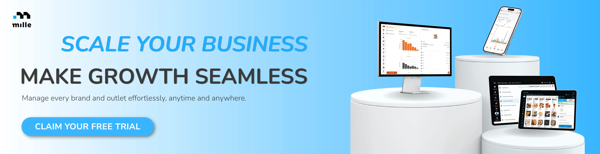

Sebuah restoran bisa memiliki meja yang selalu terisi saat akhir pekan, menerima pesanan *takeaway* pada jam makan siang, sekaligus kebanjiran *order* dari aplikasi *delivery* pada malam hari. Sekilas, kondisi ini terlihat ideal. Semakin banyak *channel* penjualan yang dimiliki, semakin banyak pula peluang untuk menjangkau pelanggan. Namun, dibalik peningkatan transaksi tersebut, ada pertanyaan yang tidak kalah penting: apakah seluruh *channel* itu benar-benar memberikan hasil yang sepadan dengan biaya dan tenaga yang dikeluarkan?

Pertanyaan ini semakin relevan bagi bisnis *food and beverage* (F&B) yang harus berhadapan dengan persaingan ketat, perubahan perilaku konsumen, dan tekanan untuk menjaga harga tetap kompetitif. Menambah *channel* penjualan memang dapat membuka akses ke pelanggan baru, tetapi setiap *channel* juga membawa kebutuhan operasional dan struktur biaya yang berbeda. Restoran yang mengandalkan pengalaman bersantap di tempat, misalnya, memiliki kebutuhan yang tidak sepenuhnya sama dengan bisnis yang sebagian besar penjualannya berasal dari pesanan *online*.

Data industri Indonesia memperlihatkan bahwa setiap *channel* memiliki peran tersendiri. Dalam laporan *Sector Trend Analysis – Foodservice Profile – Indonesia* yang diterbitkan [Agriculture and Agri-Food Canada](https://agriculture.canada.ca/en/international-trade/reports-and-guides/sector-trend-analysis-foodservice-profile-indonesia) pada 2025, dengan data pasar dari Euromonitor International, penjualan *foodservice* melalui *dine-in* masih menjadi yang terbesar pada 2024. Sementara itu, *delivery* juga memiliki nilai pasar yang signifikan. Laporan tersebut memperkirakan bahwa kedua *channel* ini akan tetap berkembang dalam beberapa tahun berikutnya. Baca laporan lengkapnya.

Artinya, bisnis F&B tidak harus memilih satu *channel* dan mengabaikan yang lain. Tantangannya adalah menentukan kombinasi yang sesuai dengan karakter produk, kebutuhan pelanggan, kapasitas operasional, dan tujuan bisnis. Sebab, strategi penjualan yang efektif bukan sekadar mendatangkan lebih banyak pesanan, melainkan memastikan setiap pesanan dapat dilayani dengan baik dan memberikan kontribusi yang layak bagi bisnis.

## *Dine-in*, *Takeaway*, dan *Delivery*: Tiga *Channel* dengan Karakter Berbeda

Sebelum memutuskan *channel* mana yang perlu diprioritaskan, pemilik bisnis perlu memahami bahwa ketiganya menawarkan pengalaman dan tantangan yang berbeda. Pilihan yang tepat bagi sebuah restoran keluarga belum tentu cocok untuk *coffee shop* kecil, gerai makanan cepat saji, atau bisnis yang beroperasi dengan dapur khusus pesanan *online*.

### 1. *Dine-in*: Ketika Pengalaman Menjadi Bagian dari Produk

*Dine-in* bukan hanya tentang menyediakan meja dan kursi. Bagi banyak restoran dan kafe, pengalaman bersantap merupakan bagian penting dari nilai yang dibeli pelanggan. Suasana ruangan, keramahan staf, kenyamanan tempat, dan cara makanan disajikan dapat menjadi alasan seseorang memilih berkunjung, bahkan ketika ada alternatif yang lebih praktis.

Karakter ini membuat *dine-in* relevan bagi restoran keluarga, kafe untuk berkumpul, restoran dengan konsep pengalaman bersantap tertentu, hingga tempat yang mengandalkan suasana sebagai daya tarik utamanya. Pengalaman yang baik juga dapat membuka peluang bagi pelanggan untuk kembali dan merekomendasikan tempat tersebut kepada orang lain.

Meski demikian, *dine-in* memiliki batas kapasitas yang nyata. Jumlah meja, waktu pelanggan berada di restoran, ketersediaan staf, dan kecepatan dapur memengaruhi jumlah pesanan yang dapat dilayani. Meja yang terisi sepanjang hari belum tentu menghasilkan performa optimal apabila waktu tunggu terlalu lama atau pergantian meja berjalan lambat.

Karena itu, evaluasi *dine-in* sebaiknya tidak hanya melihat omzet harian. Pemilik bisnis juga perlu memahami pola kunjungan berdasarkan jam, tingkat pemanfaatan meja, rata-rata nilai transaksi, serta waktu yang dibutuhkan untuk menyelesaikan pesanan. Informasi ini membantu bisnis mengetahui apakah masalah utamanya terletak pada jumlah pengunjung, kapasitas pelayanan, atau pengalaman yang membuat pelanggan belum ingin kembali.

### 2. *Takeaway*: Praktis bagi Pelanggan, Menuntut Ketepatan Operasional

*Takeaway* menawarkan cara membeli makanan tanpa harus menikmati hidangan di tempat atau menunggu pengantaran ke rumah. Bagi pelanggan yang sedang bekerja, bepergian, atau membutuhkan makanan dengan cepat, pilihan ini memberikan fleksibilitas yang berbeda dari *dine-in*.

Dari sisi bisnis, *takeaway* juga membuka peluang penjualan tanpa bergantung pada kapasitas meja. Gerai yang memiliki ruang terbatas tetap dapat melayani pelanggan yang ingin mengambil pesanan sendiri. Namun, manfaat ini baru terasa ketika proses pemesanan hingga pengambilan berjalan efisien.

Bayangkan sebuah *coffee shop* yang menerima pesanan langsung di kasir, pesanan melalui WhatsApp, dan pelanggan yang datang untuk mengambil makanan. Jika seluruh pesanan masuk melalui alur yang tidak terkoordinasi, staf dapat kesulitan menentukan urutan pengerjaan. Pesanan yang sudah selesai mungkin terlambat diambil, sementara pelanggan lain menunggu lebih lama karena antrian tidak terkelola dengan baik.

Tantangan lainnya adalah memastikan makanan tetap sesuai pesanan ketika diserahkan kepada pelanggan. Kesalahan *item*, kemasan yang kurang sesuai, atau pesanan yang tertukar dapat mengurangi manfaat dari layanan yang seharusnya praktis.

Oleh sebab itu, bisnis yang ingin mengembangkan *takeaway* perlu memperhatikan kejelasan alur pesanan, waktu persiapan, sistem pengambilan, dan akurasi transaksi. Kecepatan memang penting, tetapi kecepatan yang tidak disertai ketepatan justru berpotensi menambah pekerjaan dan biaya koreksi.

### 3. *Delivery*: Jangkauan Lebih Luas, Biaya yang Perlu Dihitung

*Delivery* memungkinkan bisnis menjangkau pelanggan yang tidak datang langsung ke lokasi. Restoran dapat melayani orang yang sedang bekerja, keluarga yang ingin makan di rumah, atau pelanggan yang berada di area yang lebih jauh dari *outlet*.

*Channel* ini juga memberikan peluang bagi bisnis untuk ditemukan melalui aplikasi pemesanan makanan. Namun, kemudahan tersebut perlu dilihat bersama biaya yang menyertainya, termasuk komisi atau biaya layanan *platform* sesuai skema yang berlaku, promosi, kemasan, dan kebutuhan tambahan untuk menjaga kualitas makanan selama perjalanan.

Misalnya, sebuah menu terjual lebih banyak melalui aplikasi *delivery* setelah mendapatkan promosi. Peningkatan transaksi tentu menjadi sinyal yang menarik, tetapi belum cukup untuk menyimpulkan bahwa kampanye tersebut menguntungkan. Bisnis masih perlu memperhitungkan biaya bahan baku, potongan atau biaya *platform*, subsidi promosi yang ditanggung *merchant*, dan biaya lain yang berkaitan dengan pemenuhan pesanan.

Selain itu, tidak semua makanan cocok dikirim dalam jarak dan durasi yang sama. Makanan berkuah, gorengan, hidangan dengan komponen renyah, atau minuman dengan *topping* tertentu mungkin membutuhkan penyesuaian kemasan dan cara penyajian. Jika kualitas produk berubah secara signifikan selama pengiriman, jangkauan yang lebih luas belum tentu menghasilkan pengalaman pelanggan yang lebih baik.

Karena itu, *delivery* sebaiknya dikembangkan dengan mempertimbangkan dua hal sekaligus: potensi permintaan dari pelanggan dan kemampuan bisnis memenuhi pesanan secara konsisten. *Channel* ini bisa menjadi peluang pertumbuhan yang berarti, selama struktur biaya dan kesiapan operasionalnya dipahami sejak awal.

## Jangan Memilih *Channel* Hanya Berdasarkan Jumlah Pesanan

Ketika satu *channel* terlihat lebih ramai daripada yang lain, wajar jika pemilik bisnis ingin segera mengalokasikan lebih banyak sumber daya ke sana. Namun, keputusan tersebut perlu didasarkan pada lebih dari sekadar jumlah transaksi atau omzet.

Setiap *channel* memiliki kebutuhan dan konsekuensi yang berbeda. *Dine-in* membutuhkan kapasitas ruang dan pelayanan, *takeaway* memerlukan alur pemesanan serta pengambilan yang tertata, sedangkan *delivery* melibatkan biaya distribusi dan tantangan menjaga kualitas produk selama perjalanan.

Karena itu, bisnis perlu membedakan omzet dari kontribusi yang tersisa setelah biaya yang relevan diperhitungkan. Dua *channel* dengan omzet yang sama bisa memberikan hasil berbeda apabila biaya pemenuhan pesanan, promosi, kemasan, atau penggunaan tenaga kerja tidak sama.

Sebagai ilustrasi, sebuah restoran memiliki dua *channel* dengan nilai penjualan masing-masing Rp10 juta dalam satu periode. Angka tersebut belum menjelaskan *channel* mana yang lebih baik. Pemilik bisnis masih perlu mengetahui biaya bahan baku, biaya *platform* jika ada, biaya promosi yang ditanggung bisnis, serta biaya operasional lain yang dapat dikaitkan dengan masing-masing *channel*. Tanpa informasi tersebut, kesimpulan tentang profitabilitas masih terlalu dini.

Perbandingan juga perlu dilakukan secara adil. Jam operasional, jumlah hari promosi, karakter menu, dan periode pengamatan sebaiknya diperhatikan agar hasilnya tidak menyesatkan. Membandingkan penjualan *delivery* saat kampanye besar dengan *dine-in* pada periode biasa, misalnya, tidak cukup untuk menentukan *channel* mana yang lebih efektif.

Dengan kata lain, *channel* terbaik bukan selalu *channel* dengan transaksi terbanyak. *Channel* yang tepat adalah *channel* yang sesuai dengan tujuan bisnis, dapat dijalankan dengan baik, dan memberikan hasil yang masuk akal setelah biaya serta kebutuhan operasionalnya dipertimbangkan.

## Bagaimana Cara Menentukan *Channel* yang Paling Sesuai?

Tidak ada satu formula yang berlaku untuk semua bisnis F&B. Namun, ada beberapa langkah yang dapat membantu pemilik bisnis mengambil keputusan secara lebih terarah.

**Pertama, pahami karakter pelanggan dan alasan mereka membeli.**

Pelanggan yang memilih restoran untuk makan bersama keluarga mungkin memiliki kebutuhan berbeda dari pelanggan yang membeli kopi sebelum berangkat kerja. Kelompok pertama bisa lebih menghargai suasana, kenyamanan, dan pelayanan, sedangkan kelompok kedua mungkin lebih mengutamakan kecepatan dan kemudahan pengambilan pesanan.

Karena itu, keputusan mengenai *channel* perlu dimulai dari pemahaman terhadap pelanggan yang ingin dilayani. Perhatikan kapan mereka membeli, menu apa yang paling sering dipesan, apakah mereka cenderung makan di tempat atau membawa pulang, serta kebutuhan apa yang ingin mereka penuhi. Informasi ini dapat diperoleh dari pengamatan transaksi, masukan pelanggan, dan pola penjualan yang tercatat.

**Kedua, evaluasi menu berdasarkan kesesuaiannya dengan setiap *channel*.**

Tidak semua menu harus diperlakukan sama di seluruh *channel*. Menu yang paling menarik saat disajikan langsung di meja belum tentu menjadi pilihan terbaik untuk pengiriman jarak jauh. Sebaliknya, produk yang praktis dikemas dan tetap stabil kualitasnya mungkin memiliki peluang lebih besar untuk dikembangkan sebagai menu *takeaway* atau *delivery*.

Bisnis dapat mulai dengan membandingkan menu yang paling sering terjual di setiap *channel*. Perhatikan pula tingkat kesalahan pesanan, kebutuhan kemasan, waktu persiapan, serta keluhan yang muncul. Jika sebuah menu memiliki permintaan tinggi tetapi sering mengalami masalah selama pengiriman, solusi yang dibutuhkan mungkin bukan menambah promosi, melainkan memperbaiki kemasan, menyesuaikan penyajian, atau menentukan area pengiriman yang lebih sesuai.

**Ketiga, hitung biaya yang relevan, bukan hanya omzet.**

Sebelum memperluas sebuah *channel*, petakan biaya yang berkaitan dengan pesanan di dalamnya. Untuk *delivery*, misalnya, perhitungan dapat mencakup biaya bahan baku, kemasan, komisi atau biaya layanan *platform*, dan promosi yang ditanggung *merchant*. Untuk *dine-in*, bisnis perlu mempertimbangkan kebutuhan pelayanan, pemanfaatan ruang, dan kapasitas staf. Sementara itu, *takeaway* memerlukan perhatian pada alur pengambilan, pengemasan, dan efisiensi pengerjaan pesanan.

Tidak semua biaya tetap mudah dipisahkan per *channel*. Biaya sewa, listrik, atau gaji staf, misalnya, bisa digunakan bersama oleh beberapa aktivitas. Oleh karena itu, metode alokasi perlu dibuat konsisten dan disesuaikan dengan tujuan analisis. Yang terpenting, pemilik bisnis mengetahui asumsi yang digunakan sehingga hasil perbandingan tidak menimbulkan kesimpulan yang keliru.

**Keempat, sesuaikan strategi dengan kapasitas operasional.**

Peningkatan permintaan seharusnya menjadi kabar baik, tetapi kapasitas yang belum siap dapat mengubahnya menjadi masalah. Jika dapur sudah kewalahan pada jam makan siang, menambah promosi *delivery* pada waktu yang sama mungkin justru memperpanjang waktu tunggu pelanggan *dine-in* dan *takeaway*.

Dalam kondisi seperti ini, bisnis perlu memahami jam sibuk, jumlah pesanan yang dapat diproses secara realistis, ketersediaan bahan baku, serta pembagian tugas tim. Penyesuaian dapat dilakukan melalui pengaturan jam promosi, penyederhanaan menu pada periode tertentu, pembagian alur pesanan, atau penyesuaian kapasitas produksi.

Tujuannya bukan menolak pesanan tambahan, melainkan memastikan bahwa pertumbuhan penjualan tidak mengorbankan kualitas pelayanan dan pengalaman pelanggan.

**Kelima, lakukan evaluasi secara berkala dan berani menyesuaikan strategi.**

Pilihan *channel* tidak harus bersifat permanen. Perubahan perilaku pelanggan, musim liburan, kondisi lokasi, hingga tren menu dapat memengaruhi hasil penjualan. Karena itu, bisnis perlu menetapkan periode evaluasi yang konsisten dan melihat bagaimana performa *channel* berubah dari waktu ke waktu.

Jika *delivery* meningkat pada hari kerja, misalnya, bisnis dapat menguji penawaran yang sesuai untuk periode tersebut. Jika *dine-in* lebih kuat pada akhir pekan, kapasitas meja dan staf dapat disiapkan dengan lebih terarah. Setiap perubahan sebaiknya diuji melalui indikator yang jelas agar keputusan berikutnya didasarkan pada hasil, bukan sekadar asumsi.

## Menghubungkan *Channel* Penjualan dengan Data Operasional

Salah satu tantangan terbesar ketika bisnis mulai melayani berbagai *channel* adalah menjaga agar informasi tetap terhubung. Pesanan *dine-in* mungkin tercatat di kasir, pesanan *takeaway* masuk melalui kanal berbeda, sementara transaksi *delivery* tercatat di *platform* lain. Ketika data tersebar, pemilik bisnis harus menghabiskan lebih banyak waktu untuk menyatukan laporan sebelum bisa memahami performa bisnis secara keseluruhan.

Padahal, semakin banyak *channel* yang digunakan, semakin penting bagi bisnis untuk memiliki gambaran yang jelas mengenai transaksi, menu, persediaan, dan hasil penjualan. Tanpa informasi yang terstruktur, bisnis berisiko mengambil keputusan berdasarkan angka yang tidak lengkap, seperti menambah stok hanya karena penjualan total meningkat tanpa mengetahui menu mana yang sebenarnya mendorong kenaikan tersebut.

Di sinilah sistem pengelolaan bisnis terintegrasi dapat membantu menyederhanakan proses. [Mille](https://millehub.com/), sebagai *integrated ERP solution* untuk bisnis F&B, menyediakan dukungan untuk pengelolaan transaksi, *online order*, *inventory*, dan laporan penjualan dalam satu ekosistem. Dengan informasi yang lebih terhubung, pemilik bisnis dapat memiliki dasar yang lebih baik untuk mengevaluasi pola penjualan, memantau kebutuhan persediaan, dan mengatur operasional sesuai permintaan.

Misalnya, ketika sebuah menu mulai banyak dipesan melalui *channel* tertentu, data penjualan dapat membantu bisnis mengenali perubahan permintaan. Informasi tersebut kemudian bisa menjadi bahan evaluasi untuk perencanaan stok, kesiapan dapur, dan pengembangan menu yang sesuai. Jika bisnis memiliki beberapa *outlet*, laporan yang tersusun dengan baik juga membantu pemilik membandingkan performa antar lokasi tanpa hanya mengandalkan ingatan atau rekap manual.

Tentu saja, sistem tidak menggantikan kebutuhan untuk menghitung biaya dan menafsirkan data secara tepat. Keputusan mengenai profitabilitas tetap bergantung pada kelengkapan informasi biaya yang dimasukkan dan metode analisis yang digunakan. Namun, ketika data transaksi dan operasional lebih mudah diakses, bisnis memiliki fondasi yang lebih kuat untuk mengambil keputusan secara konsisten.

  

## Tidak Harus Memilih Satu, tetapi Harus Tahu Prioritasnya

*Dine-in*, *takeaway*, dan *delivery* bukan tiga pilihan yang harus saling meniadakan. Bagi sebagian bisnis, *dine-in* tetap menjadi pusat pengalaman pelanggan, sementara *takeaway* membantu melayani kebutuhan yang lebih praktis dan *delivery* memperluas jangkauan pasar. Bagi bisnis lain, kombinasi yang berbeda mungkin lebih sesuai dengan produk, lokasi, dan kapasitas yang tersedia.

Yang perlu dihindari adalah menambah *channel* hanya karena pesaing melakukannya atau karena satu metode sedang terlihat populer. Setiap *channel* seharusnya memiliki alasan bisnis yang jelas, target yang realistis, serta cara evaluasi yang sesuai.

Pada akhirnya, strategi *channel* penjualan yang baik bukan tentang hadir di semua tempat sebanyak mungkin. Strategi yang baik dimulai dari pemahaman terhadap pelanggan, dilanjutkan dengan perhitungan biaya dan kesiapan operasional, lalu dievaluasi melalui data yang relevan.

Sebab, pertumbuhan bisnis F&B tidak hanya ditentukan oleh seberapa banyak pesanan yang masuk, tetapi juga oleh kemampuan bisnis memenuhi pesanan tersebut dengan konsisten. Ketika setiap *channel* dipilih dan dikelola sesuai fungsinya, bisnis memiliki peluang lebih besar untuk membangun penjualan yang berkelanjutan—tanpa kehilangan kendali atas kualitas pelayanan maupun operasionalnya.
